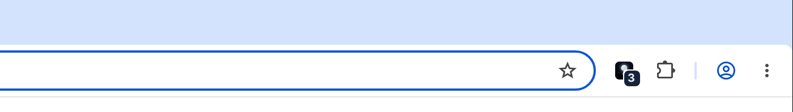

# Nullmere Stillwater

An ad blocker for Chrome, in Nullmere's own look: a black lake, a full
moon, and nothing moving on the water. It blocks ads and trackers with
[EasyList](https://easylist.to/) and EasyPrivacy, hides the slots they
leave, closes the pop-ups, and keeps out of the way.

<p>
  
  
</p>

It is a Manifest V3 extension, so Chrome itself does the blocking, from
rules made ahead of time. That has real limits, which are
[set out below](#what-it-cannot-do) rather than glossed over.

## Install

Stillwater is not on the Chrome Web Store. It is loaded from a folder.

1. Download [`dist/nullmere-stillwater-1.0.0.zip`](dist/nullmere-stillwater-1.0.0.zip)
   and unzip it somewhere it can stay (Chrome loads it from there each
   time it starts).
2. Open `chrome://extensions` and turn on **Developer mode** (top right).
3. Press **Load unpacked** and choose the unzipped folder, the one with
   `manifest.json` in it.
4. Pin it: the puzzle-piece button in the toolbar, then the pin beside
   Nullmere Stillwater.

To update, replace the folder's contents with a newer zip's and press the
reload arrow on its card in `chrome://extensions`. It needs Chrome 121 or
later.

To build it yourself instead (Node 20.15 or later, nothing to install):

```sh
cd extensions/chrome-adblocker
npm run build        # writes build/
```

and load `build/` the same way.

## Using it

The toolbar icon shows how many requests Chrome kept from the page in
front. Press it for the popup:




- **The moon is the switch.** Full, with its light on the water:
  Stillwater is filtering this site. Press the moon, or *Let this site
  through*, and the site is reloaded with nothing blocked or hidden on it
  or its subdomains; the moon turns new. Press again to still it.
- **Options** opens a page with the filter lists (each can be switched
  off), the sites let through, and five switches: hiding ad slots,
  closing pop-ups, YouTube, the count on the icon, and a pause for
  everything.


## What it does

| | |
|---|---|
| **Blocks requests** | 135,154 filters from EasyList, EasyPrivacy and a short list of Stillwater's own become 12,997 rules for Chrome's `declarativeNetRequest`, inside the 30,000 Chrome guarantees every extension. Filters for whole hosts are merged, so 94,309 hosts are blocked by 184 of those rules. |
| **Gives stand-ins** | 37 filters keep a request back by giving the page something harmless of Stillwater's own in its place, where refusing it outright would leave the page waiting on it: an empty script, text or JSON, a one-pixel image, a second of silent video, or a few lines that answer as Google's tag manager, Chartbeat or fingerprintjs2 would and send nothing. Chrome serves them from the extension; nothing is fetched. |
| **Runs scriptlets** | 30 filters name a site where a short script of Stillwater's own is to run in its pages, in the page's own world and before the site's scripts: most stop the script of an anti-adblock wall (Admiral's, on many news sites), others give a property a value the page can't change, take a script out before it runs, take a part out of what the page reads as JSON, or answer a tracker's request without sending it. Eleven kinds, written for Stillwater under the names the lists use. Only on the sites a filter names, never on a site let through, and none while paused. |
| **Hides ad slots** | 30,971 selectors. A site's own are applied as its pages begin. The 13,637 generic ones are not thrown at every page: a content script tells the extension which classes and ids a page has, and only the selectors that could match are added. They are added as the user's own style, so a page's `!important` can't undo them. A list's exception turns hiding off for a site, or for part of one by its address (a search engine's results, a router's own pages). |
| **Follows worded filters** | 291 filters pick an element by the words in it (*hide the card whose label says Sponsored*), by an XPath expression, or by the declarations the page's own style sheets give it. No style sheet can; the content script follows them as short plans. A style sheet from another site can't be read by any extension, so what only it gives is not seen. |
| **Closes pop-up ads** | 2,977 filters name the addresses of pop-up ads. A tab or window a page opens to one is closed: at once if it is opened straight there, or as it gets there if it is opened empty or by way of another address. A tab you open yourself (a new tab, a bookmark, an address you type) is never touched. |
| **Lets sites through** | Per site, from the popup or the options page, subdomains included. |
| **YouTube** | Takes the ad lists out of the data YouTube's player reads, skips or runs out an ad that plays anyway, and hides promoted tiles. Best effort: see below. |
| **Sends nothing anywhere** | The extension makes no request of its own. No account, no telemetry, no remote code, no "acceptable ads". |

The numbers are those of the lists as they stood on 15 November 2026,
commit [`4f2a9139`](https://github.com/easylist/easylist/commit/4f2a9139d44ec4e71d82ca48f86fc2a717ba603f)
of the EasyList authors' repository. A test holds this file to the build.

## On the live web

The tests above meet stand-ins: the machines Stillwater was written on
cannot reach the web. So the *Ad blocker, on the live web* workflow
loads it on real pages from one of GitHub's machines, each page once
without the extension and once with it (Chromium 153, headless, six
seconds after each page loaded). Its fifth run, on 17 November 2026:

| Page | Requests | Kept back | Ad-sized frames showing | Letters of text | Page errors |
|---|---|---|---|---|---|
| The Guardian | 183 → 136 | 21 | 0 → 0 | 20,609 → 20,617 | 0 → 19 |
| Speedtest | 3,153 → 40 | 8 | 5 → 0 | 905 → 904 | 0 → 0 |
| BBC News | 264 → 162 | 41 | 2 → 1 | 8,268 → 8,058 | 1 → 0 |
| The Independent | 416 → 82 | 25 | 1 → 0 | 9,413 → 8,528 | 0 → 0 |
| IGN | 459 → 152 | 17 | 2 → 0 | 5,177 → 5,211 | 0 → 0 |
| USA Today | 473 → 62 | 28 | 3 → 0 | 4,120 → 2,499 | 0 → 4 |
| TechCrunch | 501 → 91 | 6 | 3 → 0 | 11,158 → 11,158 | 0 → 0 |
| YouTube | 194 → 195 | 10 | 0 → 0 | 3,076 → 3,106 | 0 → 0 |
| Wikipedia (no ads) | 43 → 43 | 1 | 0 → 0 | 66,038 → 66,038 | 0 → 0 |
| GitHub (no ads) | 118 → 119 | 6 | 0 → 0 | 3,488 → 3,510 | 0 → 0 |

*Without → with.* What a page asks for falls by as much as the ads it no
longer loads would have asked. The count on the icon matched what the
check saw kept back, or was one more (the BBC, the Independent, IGN).
Everything kept back from a site's own hosts was named by a filter
written for that address: analytics beacons, telemetry and cookie
syncing (EasyPrivacy's), and on USA Today its own copy of an ad
auction's script (EasyList's `/pbjsandwichdirecta9-`). The Guardian's
nineteen errors and USA Today's four are all *Failed to fetch*: a
request the page's own code made, refused, and not caught by it. The
Guardian's text reads the same. The Independent's 885 fewer letters and USA Today's
1,621 were listed, line by line, in the seventh run (1,004 and 1,600
fewer then): paid notices (passport renewals, "GovPlus", "EaseGov", a
clinic's advertisement) and among them, on the Independent, the paper's
own headlines under their section names, and on USA Today its "Ask USA
TODAY anything" box, marked beta. That is the mix a Taboola feed shows,
and Taboola is among what EasyPrivacy keeps from every site
(`||taboola.com^$third-party`; two of its requests were kept back on
USA Today's page). Taken out with the ads, they come back on a site let
through. The frame left on the
BBC is from `buy-eu.piano.io`, which no filter names. Chromium held
nothing against the extension.

The scriptlets were seen at work on the sites they are for. On
TechCrunch the page has Admiral's `admiral` function without the
extension and none with it, its loader stopped by the scriptlets
EasyPrivacy writes against it. On USA Today, `admiral` is the harmless
function the scriptlet gives it.

YouTube served a real watch page, and the check pressed play (muted).
Without the extension the player's response in the page carried two ad
lists (`adPlacements`, `adBreakHeartbeatParams`); with it, none. The
video played either way, 22 and 21.1 seconds in after fifteen seconds,
much the same in the sixth and seventh runs. No ad showed in either run, with the
extension or without.

Some sites turn a headless browser away whatever it carries (Stack
Overflow and AccuWeather answered 403, USA Today sometimes 402, the
Daily Mail and Fandom 403 in earlier runs, CNN an empty page), and could
not be judged.

## What it cannot do

**Chrome applies the rules, not Stillwater.** Under Manifest V3 an
extension can no longer look at each request and decide; it hands Chrome
rules made ahead of time. So:

- **The lists are as new as this version.** EasyList changes many times a
  day; Stillwater's copy changes when someone runs `npm run refresh` and
  ships a new build. An ad host that appeared last week is not blocked
  until then.
- **Some filters have no rule to become** and are left out. The build
  counts them:

  | Left out | How many | Why |
  |---|---|---|
  | Exceptions that take back only a stand-in (`$redirect-rule`) | 1 | They leave the block standing; Chrome's `allow` would take back both. |
  | HTML filtering (`##^`) | 1 | It would rewrite a page before the browser reads it, which no extension may. |
  | Regular expressions Chrome refuses | 15 | Chrome's engine has no lookahead and refuses expressions that compile too large. `tools/validate.js` asks a real Chromium which. |
  | Others | 7 | Four selectors Chromium can't read, two filters for addresses that are not hosts, and one that would match every request. |

  That is 24 of 135,154 filters, 0.02%. Nothing is approximated in a
  way that blocks more than the filter meant.

**A pop-up is closed, not prevented.** No rule of Chrome's can stop a page
opening a window, so Stillwater closes it as soon as it sees where it is
going: it may show for a moment, and its first request may already have
left. A tab is watched for ten seconds after a page opens it: wherever it
is redirected in that time, and wherever it goes in the two seconds after
it first shows a page, is taken for the page's doing, since Chrome does
not say whether a person pressed something. After that a link you press
in it is yours, and so is anywhere you go by the address bar. A link you
click yourself that opens a new tab to one of these addresses is closed
too, as it is by other blockers using these lists. An ad that takes over the tab
you were in, having moved the page you wanted into a new one, is not
caught.

**YouTube is the hardest, and only part of it is verified against YouTube.**
Its ads come from the same hosts as its videos, so no rule can block
them. What Stillwater does there is tested against a stand-in page shaped
like YouTube's where it matters (see `test/e2e/youtube.test.js`). Run on
the live web, YouTube at first answered GitHub's machines with a refusal
(429) or an empty player. Since 17 November 2026 it has served a real
watch page: the ad lists the page carried without the extension were
gone with it, and the video played (see *On the live web*). No ad showed
without the extension either, so that an ad YouTube means to play is
kept from playing is still unverified; so is a page the player has to
fetch its data for, which none of these runs did. YouTube changes its player often and works against ad
blockers; expect this part to break first, and to need the *YouTube*
switch turned off, or `youtube.com` let through, if YouTube objects. It
does not hide what it does: a page that looks can tell that the functions
it reads its data with have been wrapped. With the switch off, or
YouTube let through, nothing of that part runs in YouTube's pages at all.
A player embedded in a site you have let through is left alone only from
the moment the extension has looked the site up, which is after the
player has read its first data.

**A scriptlet can be noticed.** A page that looks can tell that a property
it reads has been fixed, or a function of its own wrapped, and a wall
that looks for that can show itself again; and a site that changes its
script is missed until the lists are refreshed. They run only on the
sites their filters name, so nowhere else has anything to notice.

**The count is Chrome's.** Chrome counts what it blocked on each tab and
starts afresh as a navigation finishes. A request blocked in a page's very
first instant can be counted before that and lost: in tests here, about
one page load in seven showed a count one or two short. What was blocked
is not in doubt, only the number.

**An ad written into the page itself can only be hidden**, and only where
a list names it. Text ads a site serves from its own address look like the
site's own words to any extension.

**Chrome's own pages, the Web Store and other extensions** are closed to
every extension, this one included.

**Not yet run by a person in Google Chrome.** Everything above was checked
by automated tests in Chromium 153 (Playwright's build, headless, on
Linux), loading the unpacked extension, against stand-ins and on the
live web. The toolbar picture is Chromium's own window, on a virtual
display: the icon pinned and Chrome's count on it, read back as 3
before it was taken (`tools/toolbar.js`). It has not been installed by
hand in Google Chrome on a Mac or Windows machine. The popup and options
pictures here are the real pages, taken in that Chromium.

## Why it asks for what it asks for

When it is loaded Chrome says Stillwater can *read and change all your
data on all websites*, *read your browsing history* and *block content on
any page*. Those are Chrome's words for the permissions below. The second
is Chrome's name for two of them: reading its own count of what it
blocked, and being told when a page opens a tab and where that tab goes.
Stillwater reads the number, judges the pop-up's address, and keeps no
history of either.

| Permission | What it is used for |
|---|---|
| `declarativeNetRequest` | The rules that block requests. |
| `declarativeNetRequestFeedback` | Reading Chrome's count of what it blocked on a tab, for the popup. |
| `storage` | The sites let through and the switches. Kept on this computer. |
| `webNavigation` | Being told when a page opens a tab or window, and where it goes in its first seconds, so a pop-up ad can be closed. |
| `scripting` | Adding the style that hides ad slots to a page; registering the two YouTube scripts only while their switch is on; and registering each scriptlet for the sites its filter names, while its list is on. |
| Access to all sites | The content script that reports a page's classes and ids and follows the worded filters. It reads class names, ids, and for worded filters the text of the elements a list points at; none of it leaves the browser. |

## How it is put together

```
lists/        EasyList and EasyPrivacy at a named commit, and Stillwater's own short list
tools/        refresh-lists.js, build.js, validate.js, package.js, make-icons.js, shots.js, toolbar.js,
              live-check.js (real pages, from a machine that can reach the web)
  lib/        filters.js (reads the lists)   dnr.js (makes Chrome's rules)
              redirects.js (the stand-ins, by every name the lists give them)
              scriptlets.js (the eleven scriptlets, by the lists' names for them)
              cosmetic.js, procedural.js, selectors.js (what to hide)
              popups.js (which pop-ups to close)   zip.js, png.js
src/          the extension as written: manifest, service worker, content scripts, pages, icons,
              and redirects/, the stand-ins a request may be given instead
build/        the extension as Chrome loads it: src/ plus rules/, cosmetic/, popups/ and scriptlets/ (not kept in git)
dist/         the packed build
test/unit/    the converter, the cosmetic and pop-up data, sites, wording, the zip
test/e2e/     the unpacked extension in Chromium against a stand-in for every host
```

- `tools/lib/filters.js` reads Adblock Plus syntax. `tools/lib/dnr.js`
  turns network filters into rules and checks each against what Chrome
  requires. `tools/lib/cosmetic.js` sorts selectors into those for named
  sites, generic ones keyed by the class or id they need, and exceptions.
- A filter that gives a stand-in (`$redirect=`, `$rewrite=abp-resource:`)
  becomes a rule that sends the request to a file in `src/redirects/`,
  every one written for Stillwater. Chrome ranks such a rule above the
  blocks and below the exceptions. The files are open to the pages they
  are given to only at an address Chrome makes afresh each session, so a
  page can't look for them to tell that Stillwater is there.
- A scriptlet filter (`site##+js(name, arguments)`) becomes a file of
  its own in `build/scriptlets/`: its scriptlet from
  `tools/lib/scriptlets.js`, called with its arguments inside a function
  of its own. The service worker registers each with Chrome for the hosts
  its filter names, in the page's own world before its first script, and
  takes them away for a site let through, a list switched off, or a pause.
- `tools/lib/popups.js` turns pop-up filters into a set of hosts and a few
  hundred expressions; `src/shared/popups.js` judges an address by them.
- `src/background/service-worker.js` keeps three dynamic rules (the sites
  let through, and the pause), chooses what each frame hides (by its host
  and its address), registers the scriptlets, closes the pop-ups, and
  answers the pages. Chrome stops it when idle, so it holds
  nothing it can't make again, but for which tabs pages have opened in
  the last ten seconds.
- The icons are drawn by `tools/make-icons.js` from a few shapes: nothing
  is traced or taken from anywhere.

## Working on it

```sh
npm test             # some 80 unit tests, Node alone
npm run build        # lists/ -> build/
npm run test:e2e     # the unpacked build in Chromium (needs Playwright: npm ci && npx playwright install chromium)
npm run package      # build, then dist/nullmere-stillwater-<version>.zip
npm run refresh      # bring lists/ up to date with the EasyList repository
```

After a refresh: `npm run build && node tools/validate.js && npm run build`
(the middle step asks Chromium which regular expressions and selectors it
refuses and records them in `lists/rejected.json`), then
`npm run test:e2e`, `npm run package`, update the numbers in this file
(`npm test` says which), and commit.

The browser tests start a local server and tell Chromium that every host
name is that server, so pages can ask for real ad hosts and the tests can
see which requests never arrived. Nothing in them goes out to the network.

The **Ad blocker** workflow (`.github/workflows/adblocker.yml`) runs all
of it on every change under this folder, checks that the zip in `dist/`
is exactly a fresh build, and keeps the zip as the run's artifact.

The **Ad blocker, on the live web** workflow
(`.github/workflows/adblocker-live.yml`), run by hand, loads the build in
Chromium on real pages with and without the extension and reports what
it found (`node tools/live-check.js` does the same anywhere the web can
be reached; `LIVE_ONLY=YouTube` narrows it). It fails only if Chromium
holds an error against the extension: the web changes too often to hold
a page's numbers to anything.

## Licences and thanks

Stillwater's own code, art and list are part of Nullmere, under the GNU
Affero General Public License, version 3 only, like the rest of it.

EasyList and EasyPrivacy are the work of the EasyList authors and their
contributors, used under the GNU General Public License, version 3 or
later. The rules, selectors and pop-up addresses in the packed extension
are derived from them and carry the same licence.
[`THIRD-PARTY-NOTICES.md`](THIRD-PARTY-NOTICES.md) says exactly what is
taken, from where, and how it is changed. The EasyList authors do not
endorse this extension; faults in how their filters are converted are
this project's.

The way YouTube's player response is pruned follows what the
[uBlock Origin](https://github.com/gorhill/uBlock) project worked out;
no code of theirs is used.
